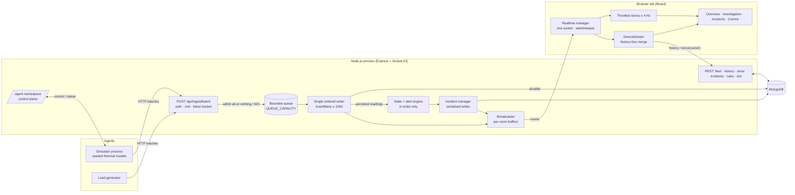
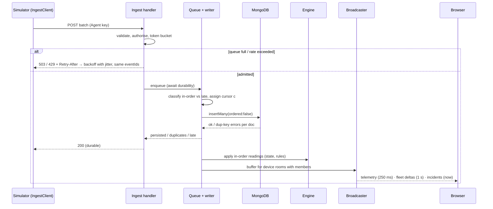
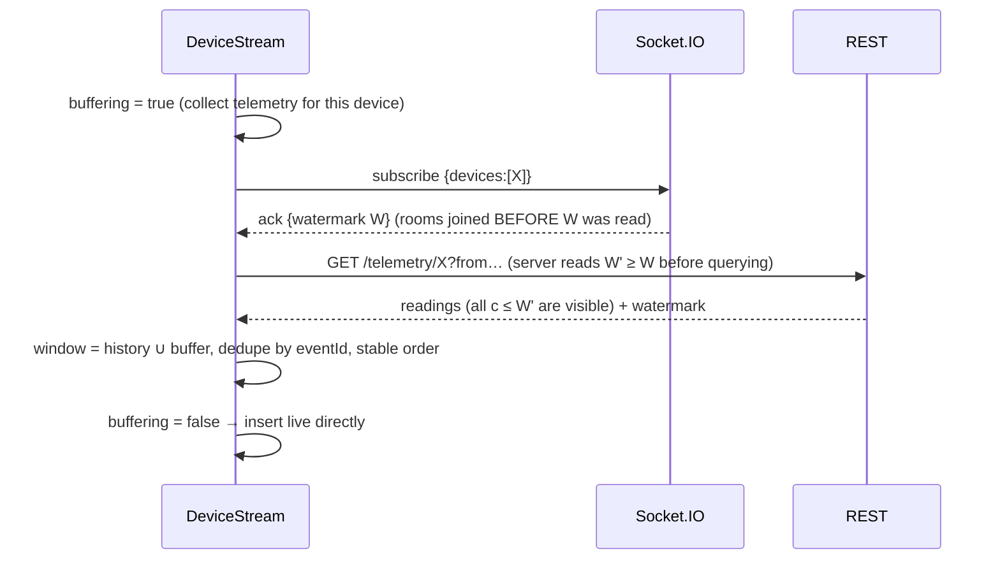
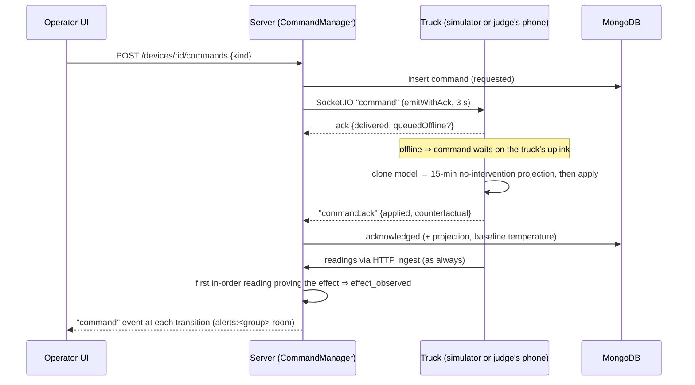

# ColdGuard architecture

## 1. System overview



## 2. Data flow of one reading



## 3. Event identity, ordering and duplicates

| Concept | Definition |
|---|---|
| `eventId` | Globally unique id minted by the source (`device:session:seq` in the simulator). Stored as `_id`, so the DB rejects re-delivery. |
| `sessionId` | Changes when a source restarts; `seq` restarts at 0 in a new session. |
| `seq` | Per (device, session), strictly increasing. Authoritative order within a session. |
| `observedAt` | Device clock (ms). Used for display order and rule timing. Must be within [now − 6 h, now + 30 s]. |
| `receivedAt` | Server clock when the request arrived. Used for offline detection, latency and TTL retention. |
| `c` (cursor) | Server commit cursor, assigned by the single writer in batch order: `max(previous + 1, wall-clock µs)`. "c ≤ committed" ⇒ durable and visible to queries. Survives restarts (high-water mark persisted, plus the clock floor). |

**Duplicates.** Unique `_id` (eventId) plus unique `(d, s, q)`. A re-minted eventId for the same source position is still a duplicate. Duplicates count toward the HTTP result, so a retry after a lost response is safe. On the client, `ReadingWindow` dedupes again by eventId, because the history/live overlap and catch-up overlap are expected.

**Late / out-of-order policy.** Before inserting, the writer classifies each reading against the device's current position:
- same session: newer iff `seq` is higher;
- different session: newer iff `observedAt` is later (a restart).

Non-newer readings are stored with `late: true` and **shown in history at their observed position**, but they **never change current state, sparklines or alert state machines**. A stale reading can't reset a device to "healthy" or re-open an incident. Any persisted reading, late or not, does prove connectivity for offline detection.

**Display order** (all clients, any arrival order): `(observedAt, deviceId, sessionId, seq, eventId)`.

## 4. History + live consistency



- **No loss:** a reading with `c ≤ W'` was committed before the query and is in the result (if in range). A reading with `c > W'` was committed after the join, so it was broadcast to this socket and is in the buffer or arrives later.
- **No duplicates:** the overlap (committed before the query, broadcast after the join) is removed by eventId.
- **Deterministic out-of-order:** insertion is by binary search on the stable order key.
- **Filter changes:** every load increments a generation counter and aborts the previous request. Responses and events from old generations are dropped. Telemetry for other devices is ignored, and fleet deltas for devices outside the current corridors are discarded.
- **Reconnect:** on `subscribed(reconnect)` the stream fetches `GET /telemetry/X/since?cursor=<max c seen>`, ordered by `c`, using the `(d, c)` index. Per-device broadcasts preserve commit order on one connection, so every reading at or below the highest received cursor has already been seen. A gap above 5,000 events produces **refresh required** instead of a silent partial view.
- **Raw vs aggregated:** ranges with ≤ 5,000 readings are raw. Otherwise the server returns min/avg/max buckets for `[from, aggEnd)` and raw readings for `[aggEnd, to]`, where `aggEnd` is the start of the current bucket. Buckets and tail partition the data exactly; this is tested. Live readings with `t ≥ aggEnd` join the raw tail. A late reading with `t < aggEnd` belongs to an already-aggregated bucket, so it is **counted, not drawn**, until refresh. The UI shows this count.
- **Current state never moves backwards:** see §3. Fleet deltas also carry a per-device version `v`, and the client ignores `v ≤ current`.

## 5. Data model and indexes

| Collection | Shape | Indexes |
|---|---|---|
| `telemetry` | `{_id: eventId, d, s, q, t: Date, r: Date, c, tc, h, b, cs, p?, late?, a}` | `_id` unique; `{d,s,q}` unique; `{d,t}` history/aggregation; `{d,c}` catch-up; `{r}` TTL = `RETENTION_HOURS` |
| `incidents` | `{_id, deviceId, groupId, type, severity, state, active, openedAt, triggeredAt, explanation, rule, evidence{first,trigger,peak,readings,slope}, ack{by,at,note}, recoveringSince, resolvedAt, timeline[]}` | `{deviceId,type}` **unique partial where active:true** (dedupe at DB boundary); `{groupId,active,triggeredAt}`; `{deviceId,triggeredAt}` |
| `devices` | catalogue: name, kind, group, origin/destination, product, simulated doses/value | `{groupId}` |
| `device_state` | snapshot of current state + source position, flushed every 5 s | `_id` |
| `users` | `{_id: username, passwordHash (bcrypt), role, groups}` | `_id` |
| `agents` | `{_id: agentId, secretSha256, groups}` | `_id` |
| `settings` | `rules` (alert config), `cursor` (high-water mark) | `_id` |

**Why not a time-series collection?** MongoDB time-series collections don't support unique indexes, and idempotent ingestion depends on one. The ordinary collection with `(d, t)` and `(d, c)` compound indexes serves both access patterns. Long ranges are aggregated at query time (`$group` by `t − t mod bucket`, ≤ 720 buckets). A pre-computed rollup collection would be the next step for multi-day ranges.

## 6. Message formats (Socket.IO)

```ts
// client → server
subscribe({ groups: string[], devices: string[] }, ack(SubscribeAck))   // replaces previous subscriptions
clock(ack(serverTime))                                                  // NTP-style offset probe

// server → client
telemetry { st, events: Reading[] }          // device rooms, compact keys: id,d,s,q,t,r,c,tc,h,b,cs,p?,late?
fleet     { st, states: DeviceState[] }      // group rooms, only changed devices, versioned
incident  Incident                           // alerts:<group>
platform  PlatformMetrics                    // measured, 1 Hz
resync    { reason: 'slow-consumer' | 'server-restart' }
```

## 7. Incident rules (demo defaults, editable)

| Rule | Opens when | Resolves when |
|---|---|---|
| `temp_high` / `temp_low` (critical) | outside 2–8 °C continuously for `sustainSec` (20 s), by device time | inside `limit ∓ hysteresis` (0.5 °C) continuously for `recoverySec` (20 s); dipping into the hysteresis band or relapsing restarts the clock |
| `rapid_drift` (warning) | least-squares slope over `driftWindowSec` (60 s, ≥ 8 readings, ≥ half window) has magnitude ≥ 1.5 °C/min, with no excursion open | slope magnitude < 0.75 °C/min for `recoverySec`, or escalation to an excursion |
| `sensor_offline` (warning) | no reading *received* for `offlineSec` (15 s), by server clock | any reading is persisted |
| `low_battery` (warning) | battery < 15 % | battery ≥ 20 % |

Explanations are generated from the actual readings: first breach, trigger, peak, count, slope and cooling state, plus the rule parameters.

## 8. Back-pressure and overload behaviour

| Condition | Behaviour |
|---|---|
| Per-agent rate > `AGENT_RATE_EPS` | 429 + Retry-After; nothing enqueued |
| Batch would exceed `QUEUE_CAPACITY` | 503 + Retry-After; nothing enqueued |
| DB write failure | 503 retryable (events not acknowledged) |
| Client (simulator) | bounded outbox (drops oldest **locally and counts it** if full), concurrency ≤ 4, exponential backoff with jitter, honours Retry-After, idempotent retries |
| Slow browser | moved to `lagging` room (bounded server buffering) → `resync` → cursor catch-up |
| Browser buffers | live buffer during load ≤ 20k (else refresh required); view window ≤ 25k points; pending fleet deltas ≤ 20k |

**Acceptance vs durability:** there is no asynchronous acceptance. A 200 always means persisted (or already persisted). The queue lives in memory, so a crash loses only events that were never acknowledged; their senders retry.

## 9. Client performance

- One socket per tab. Views declare needs with `realtime.want(key, …)`, and the manager sends the union.
- Stores mutate in place and notify React at a bounded cadence (fleet 4 Hz, device chart 4 Hz, incidents 5 Hz). The persisted event rate and the chart refresh rate are independent: at 1 Hz or 1 kHz per device, the chart redraws at most 4 times a second from the same bounded buffer.
- `DeviceRow` is memoised on the state object identity, and the list is virtualised with TanStack Virtual.
- uPlot draws thousands of points on canvas. Aggregated mode keeps ≤ 720 buckets.
- Timers, sockets, listeners and requests are cleaned up on navigation (stream `dispose()`, AbortController).

## 10. Trade-offs and scaling limits

- **Single instance.** Rooms, the commit cursor and the state engine live in one process. Scaling out would need the Socket.IO Redis/Mongo adapter, partitioning devices across writers (per-partition cursors), and a shared state store. This isn't needed at the measured load.
- **Single ordered writer.** It makes the cursor/watermark proof simple. It is also the observed bottleneck at ≈14.5k ev/s on the test laptop (`insertMany` of 1,000 docs ≈ 50 ms). The next step would be 2–4 pipelined writers whose committed watermark is the minimum contiguous completed cursor.
- **Batching window.** The 250 ms telemetry window costs about 125 ms of median latency in exchange for far fewer socket frames. It is configurable via `TELEMETRY_EMIT_MS`.
- **Tokens in sessionStorage.** Chosen to allow per-tab users for the demo. The trade-off is XSS exposure, mitigated by a strict CSP, no `dangerouslySetInnerHTML`, and 8 h expiry. Production would use httpOnly cookies.
- **Global alert rules.** Per-product rule profiles would be a natural extension.

## 11. Response, replay and evidence (signature features)

### Operator commands (interactive rescue)



- Transport is pluggable: commands for `guest` trucks go to the room `driver:<deviceId>` (the phone), all others to the `/agent` namespace (simulator).
- "Effect observed" is decided by the server from persisted telemetry only: door sensor closed; cooling state normal or backup **and** ≥ 0.3 °C below the temperature at acknowledgement.
- Commands still in `requested` are re-delivered when the simulator or the phone (re)connects. If the device's "applied" overtakes the delivery ack, "delivered" is recorded implicitly (a race caught by a test).
- Collection `commands` (`{deviceId, requestedAt}` index). Incident timelines get `action` entries.

### Incident replay

`GET /incidents/:id/replay` returns the stored readings for `[openedAt − 6 min, resolvedAt + 1 min]` (≤ 2 h), related incidents and commands, plus a **story** built by `server/src/replay.ts`:

| Event | Rule |
|---|---|
| Door opened / closed | `door` field transitions |
| Compressor fault / backup / primary restored | `cs` transitions |
| Humidity rising | first reading ≥ median of the first 2 min + 8 %RH |
| Temperature began climbing | walk back from the first breach (or the alert) along a centred 5-reading moving average while it stays within 0.1 °C of the running minimum; take the last point still at that floor |
| First breach / peak / back in range | thresholds on readings |
| Truck lost connectivity | readings with `receivedAt − observedAt ≥ 10 s` (store-and-forward backfill) |
| Alerts, acks, commands | from incidents and commands |

**Possible contributing factors:** a door opening of ≥ 30 s or a compressor fault that overlaps `[onset − 15 min, first breach]`, with its timing relative to the onset and its evidence (duration, humidity change, number of fault readings). Every factor carries the caveat that telemetry shows co-occurrence, not cause. If none apply, the replay says no recorded event explains the rise.

### Heat-exposure budget

`exposure += ((excess(a) + excess(b)) / 2) × Δt_min` over consecutive **in-order** readings, where `excess(v) = max(0, v − high, low − v)`. Gaps over 60 s are not integrated, so missing data is never treated as either safe or unsafe. Kept per device in `DeviceState.exposure`, persisted with the state snapshot, and reset only by a demo reset. `exposure_budget` (critical) opens when `exposure ≥ exposureBudgetCMin` (default 20 °C·min). It resolves after the recovery time in band, but the budget stays spent. Replay and reports recompute exposure from *all* stored readings in their window by observed time, including late ones.

### Tamper-evident evidence chain

```
leaf_i     = sha256(canonical(reading_i))[0:16]        canonical = id|d|s|q|t|r|c|tc|h|b|cs|door|late
readings_k = sha256(canonical(r_1) "\n" … canonical(r_m))      (block k, cursor order)
hash_k     = sha256(d | k | fromC | toC | count | readings_k | hash_{k−1})     hash_{−1} = sha256("coldguard-genesis:"+d)
```

- Sealed after persistence, per device, every ≤ 60 readings or ≤ 10 s, by a serialised writer (`evidence` collection, `{d, n}` index). Commit order means late and backfilled readings are covered too.
- `GET /devices/:id/evidence` re-reads the last ≤ 500 blocks and their readings by cursor range and reports the first break: link broken, block header altered, reading altered (with event id), reading missing, or extra reading (anything stored inside a sealed range that was never sealed).
- The **unsealed tail** (persisted but not yet sealed, or lost from memory by a crash before sealing) is reported separately and never claimed as verified.
- `GET /incidents/:id/report` exports the readings, blocks and the previous block hash for the incident window. `server/src/verifyReport.ts` verifies the file offline.
- Limits: this proves *integrity since sealing* inside one deployment. It does not prove a device told the truth, and an attacker who controls the server can re-seal. Anchoring heads externally (e.g. publishing the head hash) would be the next step.

### Judges join by QR (phone trucks)

- `POST /guest/invite` (operator) stores `{code, expiresAt, maxClaims: 12}`. `POST /guest/claim {code, name}` (public, rate-limited, name validated) assigns a free `GT-xx` truck (`guests` collection, unique per truck, 2 h expiry) and returns a **driver JWT** `{role: 'driver', dev}`.
- A driver can read only its own truck (REST and Socket.IO), cannot issue commands, and joins no fleet-wide rooms. It may ingest only readings for its truck (`Authorization: Bearer`), through the same validation and pipeline, with its own token bucket (50 ev/s, burst 1,500 for tunnel backfill).
- The phone runs the shared `ThermalModel` (also used by the simulator) at 1 Hz. It buffers in the tunnel, uploads with backoff, and answers `command` requests on its socket.
